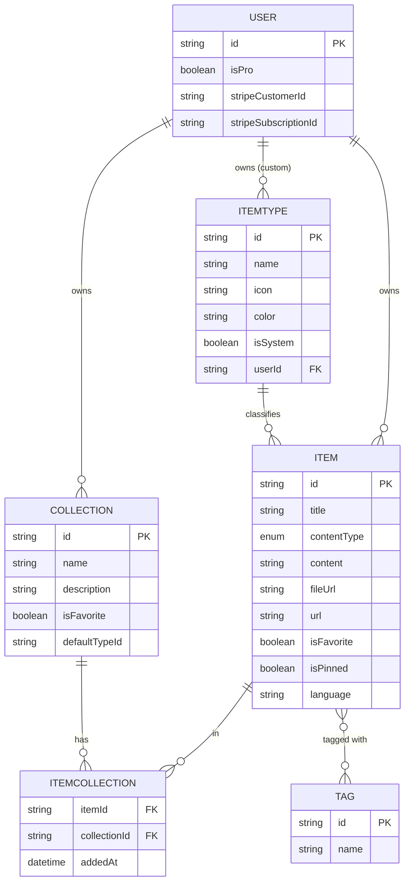

# DevStash — Project Overview

> One fast, searchable, AI-enhanced hub for all developer knowledge and resources.

DevStash is a SaaS knowledge hub for developers to store, organize, and instantly
retrieve **snippets, commands, prompts, notes, files, images, links, and custom types**.

---

## 🎯 Problem (Core Idea)

Developers keep their essentials scattered across too many places:

| Resource | Where it usually lives |
| --- | --- |
| Code snippets | VS Code, Notion |
| AI prompts | Chat histories |
| Context files | Buried in projects |
| Useful links | Browser bookmarks |
| Docs | Random folders |
| Commands | `.txt` files, bash history |
| Project templates | GitHub gists |

This causes **context switching, lost knowledge, and inconsistent workflows**.
DevStash consolidates everything into a single, fast, AI-enhanced hub.

---

## 👥 Target Users

- **Everyday Developer** — needs a fast way to grab snippets, prompts, commands, and links.
- **AI-first Developer** — saves prompts, contexts, workflows, and system messages.
- **Content Creator / Educator** — stores code blocks, explanations, and course notes.
- **Full-stack Builder** — collects patterns, boilerplates, and API examples.

---

## ✨ Features

### A. Items & Item Types

Every piece of knowledge is an **Item** with a **type**. Users can create custom types
(Pro), but the app ships with these **system types** (immutable):

| Type | Data kind | Availability |
| --- | --- | --- |
| `snippet` | text | Free |
| `prompt` | text | Free |
| `note` | text | Free |
| `command` | text | Free |
| `link` | url | Free |
| `file` | file | **Pro only** |
| `image` | file | **Pro only** |

- A type resolves to one of three data kinds: **text**, **url**, or **file**.
- Item lists are routed by type, e.g. `/items/snippets`.
- Items are **quick to create and access via a drawer**.

### B. Collections

Users create **Collections** that can hold items of any type. An item can belong to
**multiple collections** (e.g. a React snippet in both *"React Patterns"* and *"Interview Prep"*).

Examples: *React Patterns* (snippets, notes) · *Context Files* (files) · *Python Snippets* (snippets)

### C. Search

Powerful search across **content · tags · titles · types**.

### D. Authentication

Email / password or **GitHub** sign-in (NextAuth v5).

### E. Core Features

- ⭐ Collection & item favorites
- 📌 Pin items to top
- 🕘 Recently used
- 📥 Import code from a file
- ✍️ Markdown editor for text types
- 📎 File upload for file types (file / image)
- 📤 Export data in multiple formats
- 🌙 Dark mode (default for devs)
- 🔀 Add / remove items to/from multiple collections
- 🔎 View which collections an item belongs to

### F. AI Features (Pro only)

- 🏷️ AI auto-tag suggestions
- 📝 AI summaries
- 💡 AI "Explain This Code"
- ⚙️ Prompt optimizer

---

## 🗄️ Data Model

> **Migrations only.** Never use `prisma db push` or edit the DB structure directly.
> Create migrations, run them in dev, then in prod.

### Entity Relationship Diagram



### Prisma Models (draft)

> Rough mockup — not final. `User` extends the NextAuth schema (accounts/sessions omitted).

```prisma
enum ContentType {
  TEXT
  URL
  FILE
}

model User {
  id                   String   @id @default(cuid())
  name                 String?
  email                String?  @unique
  emailVerified        DateTime?
  image                String?
  password             String?  // bcrypt hash for email/password sign-in

  // Billing
  isPro                Boolean  @default(false)
  stripeCustomerId     String?  @unique
  stripeSubscriptionId String?  @unique

  // Relations
  items       Item[]
  collections Collection[]
  itemTypes   ItemType[]   // custom types created by this user
}

model ItemType {
  id       String  @id @default(cuid())
  name     String
  icon     String  // lucide icon name, e.g. "Code"
  color    String  // hex, e.g. "#3b82f6"
  isSystem Boolean @default(false)

  // null for system types; set for custom (Pro) types
  userId String?
  user   User?   @relation(fields: [userId], references: [id], onDelete: Cascade)

  items Item[]
}

model Item {
  id          String      @id @default(cuid())
  title       String
  contentType ContentType @default(TEXT)
  content     String?     // text content, or null for files
  fileUrl     String?     // Cloudflare R2 URL, or null for text
  fileName    String?     // original filename
  fileSize    Int?        // bytes
  url         String?     // for link types
  description String?
  isFavorite  Boolean     @default(false)
  isPinned    Boolean     @default(false)
  language    String?     // optional, for code highlighting

  createdAt DateTime @default(now())
  updatedAt DateTime @updatedAt

  // Relations
  userId      String
  user        User             @relation(fields: [userId], references: [id], onDelete: Cascade)
  itemTypeId  String
  itemType    ItemType         @relation(fields: [itemTypeId], references: [id])
  tags        Tag[]
  collections ItemCollection[]

  @@index([userId])
  @@index([itemTypeId])
}

model Collection {
  id            String   @id @default(cuid())
  name          String
  description   String?
  isFavorite    Boolean  @default(false)
  defaultTypeId String?  // default type for a new, empty collection

  createdAt DateTime @default(now())
  updatedAt DateTime @updatedAt

  // Relations
  userId String
  user   User             @relation(fields: [userId], references: [id], onDelete: Cascade)
  items  ItemCollection[]

  @@index([userId])
}

// Join table (many-to-many between Item and Collection)
model ItemCollection {
  itemId       String
  collectionId String
  addedAt      DateTime @default(now())

  item       Item       @relation(fields: [itemId], references: [id], onDelete: Cascade)
  collection Collection @relation(fields: [collectionId], references: [id], onDelete: Cascade)

  @@id([itemId, collectionId])
}

model Tag {
  id    String @id @default(cuid())
  name  String
  items Item[]
}
```

> **Note:** The original spec listed `contentType` as `text | file`. Because links are
> a first-class kind, it is modelled as an enum `TEXT | URL | FILE` — confirmed and shipped
> in the `init` migration. See `prisma/schema.prisma` for the applied schema.

---

## 🛠️ Tech Stack

| Layer | Choice |
| --- | --- |
| **Framework** | [Next.js 16](https://nextjs.org) / [React 19](https://react.dev) — SSR pages + dynamic components, API routes for backend (items, uploads, AI) |
| **Language** | [TypeScript](https://www.typescriptlang.org) |
| **Database** | [Neon](https://neon.tech) — serverless PostgreSQL (cloud) |
| **ORM** | [Prisma 7](https://www.prisma.io) *(fetch latest docs)* |
| **Caching** | [Redis](https://redis.io) *(maybe)* |
| **File Storage** | [Cloudflare R2](https://developers.cloudflare.com/r2/) |
| **Auth** | [NextAuth v5](https://authjs.dev) — email/password + GitHub OAuth |
| **AI** | [OpenAI](https://platform.openai.com) — `gpt-5-nano` |
| **Styling** | [Tailwind CSS v4](https://tailwindcss.com) + [ShadCN UI](https://ui.shadcn.com) |

- Single codebase / repo to minimize overhead.
- ⚠️ **Never** `db push` or modify DB structure directly — always use migrations (dev → prod).

---

## 💰 Monetization (Freemium)

> Build the foundation for Pro gating now, but **during development all users can access everything.**

| | **Free** | **Pro — $8/mo or $72/yr** |
| --- | --- | --- |
| Items | 50 total | Unlimited |
| Collections | 3 | Unlimited |
| System types | All except file/image | All |
| File & image uploads | ❌ | ✅ |
| Custom types | ❌ | ✅ *(later)* |
| Search | Basic | Basic |
| AI auto-tagging | ❌ | ✅ |
| AI code explanation | ❌ | ✅ |
| AI prompt optimizer | ❌ | ✅ |
| Data export (JSON / ZIP) | ❌ | ✅ |
| Support | — | Priority |

---

## 🎨 UI / UX

**General direction**

- Modern, minimal, developer-focused.
- Dark mode by default; light mode optional.
- Clean typography, generous whitespace, subtle borders and shadows.
- Syntax highlighting for code blocks.
- References: **Notion · Linear · Raycast**.

### Screenshots
- Refer to the screenshots below as a base for the dashboard UI.
- It does not have to be exact, use it as a reference.
- @context/screenshots/dashboard-ui-main.png
- @context/screenshots/dashboard-ui-drawer.png

**Layout**

- **Sidebar + main content**, sidebar collapsible.
  - *Sidebar:* item types linking to their item lists (Snippets, Commands, …) + latest collections.
  - *Main:* grid of color-coded **collection cards** (background color = dominant item type).
    Items render as color-coded cards (border color = type).
- Individual items open in a **quick-access drawer**.

**Type Colors & Icons** *(lucide-react)*

| Type | Icon | Color | Swatch |
| --- | --- | --- | --- |
| Snippet | `Code` | `#3b82f6` (blue) | 🟦 |
| Prompt | `Sparkles` | `#8b5cf6` (purple) | 🟪 |
| Command | `Terminal` | `#f97316` (orange) | 🟧 |
| Note | `StickyNote` | `#fde047` (yellow) | 🟨 |
| File | `File` | `#6b7280` (gray) | ⬜ |
| Image | `Image` | `#ec4899` (pink) | 🟪 |
| Link | `Link` | `#10b981` (emerald) | 🟩 |

**Responsive**

- Desktop-first, mobile usable.
- Sidebar collapses into a drawer on mobile.

**Micro-interactions**

- Smooth transitions · hover states on cards · toast notifications · loading skeletons.
